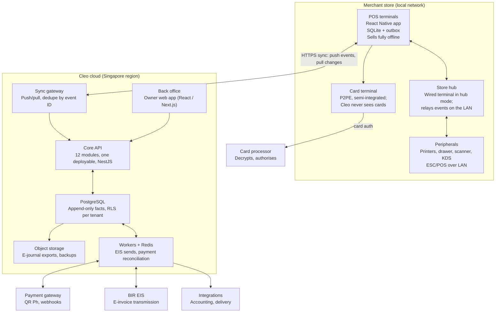
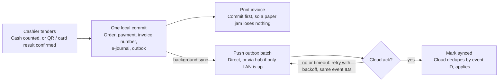
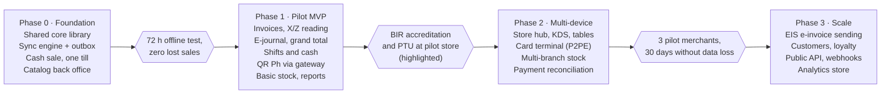

# Cleo POS — System Architecture Design

> **Source.** A faithful Markdown version of [`Cleo-POS-System-Architecture-Design.pdf`](Cleo-POS-System-Architecture-Design.pdf) (19 Nov 2026, 28 pages). Section numbers, the seven principles, every table, the twelve modules, ADRs 001–010 and the section 14 fixes are kept as written; the three diagrams are redrawn as Mermaid with their original captions. The only addition is the final section, **[Platform mapping](#platform-mapping)**, which reproduces the owner's fixed platform (superprompt section 1A).
>
> **How to read it with the fixed platform.** This document is the contract for every overhaul phase. Its *principles* apply in full. Its *infrastructure and technology recommendations* (React Native, SQLite, NestJS, Redis, containers, Terraform, a Singapore cloud region) are overridden by the [Platform mapping](#platform-mapping) and by [ADR-012](adr/ADR-012-fixed-platform.md). Where a requirement and the platform conflict, the gap is recorded in [`GAP_ANALYSIS.md`](GAP_ANALYSIS.md) and raised as gate G1 or G6.

---

## 1. Executive summary

Cleo should be built as an offline-first, cloud-synced POS: every terminal runs a complete local sales engine, a designated in-store hub keeps devices in step over the LAN, and a cloud backend (a modular monolith on PostgreSQL) owns configuration, reporting and compliance transmission. This is the same shape Toast, Square and Lightspeed converged on after years of production outages, and it fits Philippine conditions where connectivity is unreliable and BIR rules treat each terminal as a registered machine.

The architecture rests on seven principles. Every later section traces back to one of them.

1. **The sale never waits for the network.** Ringing up, taking cash, printing the invoice and closing the drawer must work with zero connectivity.
2. **Split authority by data type.** The cloud owns reference data (catalog, prices, users, tax rules). The terminal owns the transactions it creates (orders, payments, invoices, shifts).
3. **Money and tax records are append-only facts.** A void, refund or correction is a new record, never an edit or delete. This is also what BIR's audit rules demand.
4. **Every write is idempotent.** Each event and payment carries a client-generated ID, so retries after a timeout can never double-charge or double-count.
5. **Cleo never touches card data.** Card payments run through a semi-integrated, P2PE terminal; Cleo only sees amounts, statuses and tokens. This keeps Cleo largely outside PCI DSS scope.
6. **Monolith first, split on evidence.** One deployable backend with strict internal module boundaries. Extract a service only when load or team size proves the need.
7. **Compliance is a module, not a report.** Non-resettable grand totals, sequential invoice numbers, the e-journal and Z-readings are core domain objects from day one.

The recommended stack is TypeScript end to end: React Native on Android terminals, SQLite on device, NestJS on Node in the cloud, PostgreSQL, and a React back office. Section 11 gives the alternatives and why each was passed over.

## 2. How leading POS systems are built

All five market leaders run the sale on the device and treat the cloud as a sync and management layer; they differ mainly in how devices in one store talk to each other while offline, and in how card payments degrade.

| Platform | Terminal platform | Offline approach | Card payments offline | Extensibility | Lesson for Cleo |
|---|---|---|---|---|---|
| [Toast](https://doc.toasttab.com/doc/platformguide/platformOfflineModeLocalSync.html) | Android is the foundation of its POS products ([careers page](https://careers.toasttab.com/jobs/staff-software-engineer-android-remote-united-states)) | "Offline mode with local sync": one wired, always-on device is auto-elected as a local hub and relays updates between devices and to the cloud | Taken offline, captured later; EMV chip, gift cards and loyalty disabled offline | Partner APIs | Elect a hub device on the LAN instead of selling a server box |
| [Square](https://developer.squareup.com/docs/mobile-payments-sdk/ios/offline-payments) | iOS and Android apps plus own hardware | Device stores payments locally and forwards them when the connection returns | SDK routes each payment online or offline based on network and server health; a queued payment is not yet processed and can still decline | Public REST APIs; every write takes an [idempotency key](https://developer.squareup.com/docs/build-basics/common-api-patterns/idempotency) | Idempotency keys on every write; make offline risk an explicit merchant setting |
| [Shopify POS](https://shopify.engineering/react-native-future-mobile-shopify) | React Native, built from the ground up ([Shipit Q&A](https://shopify.engineering/shipit-writing-react-native-apps)) | Local cart and checkout, sync on reconnect | Via Shopify terminal hardware | [POS UI extensions](https://shopify.dev/apps/pos/cart) let third parties add screens | A cross-platform TypeScript stack can run a top-tier POS |
| [Clover](https://docs.clover.com/docs/clover-architecture) | Android-based integrated hardware and software | On-device apps with local data | Device-managed; risk settings are merchant-chosen | REST API, Android SDK, app market, and [REST Pay Display](https://docs.clover.com/docs/clover-development-basics-semi) so any HTTP-capable POS can drive a card terminal | Semi-integration: the POS sends an amount, the terminal handles the card |
| [Lightspeed Restaurant](https://k-series-support.lightspeedhq.com/hc/en-us/articles/53028167251867-Offline-POS-functionality) | iPad | Active POS keeps a local cache; printers and KDS keep working over the LAN. An older line used a [LiteServer](https://resto-support.lightspeedhq.com/hc/en-us/articles/115003529548) box that mirrors the cloud | Integrated payments stop; terminal falls back to standalone mode over LTE | APIs and integrations | Dedicated server hardware was a stepping stone the industry moved away from |

Three further patterns recur across these and other vendors:

- **Local outbox until acknowledged.** CloudKitchens' Otter POS keeps events in a local database until the server confirms receipt, then clears them ([engineering blog](https://techblog.cloudkitchens.com/p/otterpos-outage-resilience)). Cleo adopts this exactly.
- **Wall-clock conflict resolution fails.** A tablet whose clock runs two seconds slow can overwrite a manager's newer price change under last-write-wins ([example](https://dev.to/mathan_kumar_208c3761951a/architecting-for-unstable-networks-solving-distributed-state-conflicts-in-restaurant-pos-systems-3e09)). Cleo orders changes by server sequence numbers, not device clocks.
- **Offline mode must cover real selling.** Vendors and analysts agree that a cash-only fallback is not a real offline mode ([KWI](https://www.kwi.com/blog/reliability-wrong-metric-retail-pos/)). Cleo's offline mode covers the full sale, receipt, drawer and shift flow.

## 3. Requirements and quality attributes

Cleo's target customer is a Philippine SMB (retail, food service, multi-branch) running Android hardware on unreliable internet, which must pass BIR accreditation and accept QR Ph alongside cash and cards.

### 3.1 Functional scope

- **Selling:** catalog with variants and modifiers, barcode lookup, cart, discounts (including statutory Senior Citizen and PWD discounts), split tender, held and open orders, tables and tabs for food service.
- **Payments:** cash with change, QR Ph (covers GCash, Maya and bank apps), card via terminal, refunds and voids with manager approval.
- **Shifts and cash:** opening fund, cash in and out, blind close, short or over, X-reading per cashier shift.
- **Compliance:** sequential invoice numbers per terminal, end-of-day Z-reading, non-resettable accumulated grand total, electronic journal, BIR backend sales reports, and e-invoice transmission to the BIR EIS.
- **Inventory:** stock per branch, receiving, transfers, adjustments, recipe or bill-of-materials deduction for food service.
- **Back office:** products, prices, users and roles, branch and terminal management, reports, exports.
- **Kitchen and peripherals:** receipt and kitchen printers, cash drawer, scanner, customer display, kitchen display (KDS).

### 3.2 Quality attribute targets

These are Cleo's design targets, set from the vendor behaviour in section 2; validate them during the pilot.

| Attribute | Target | Why it matters |
|---|---|---|
| Offline operation | Full selling for at least 72 hours with no internet | Outages in provincial areas can run past a business day |
| Checkout latency | Item add under 100 ms; invoice print started under 1 s after tender, all local | Queue speed is the cashier's main complaint |
| Data durability | Zero lost transactions after a terminal crash or power cut | BIR requires non-volatile recording; lost sales are lost tax records |
| Sync freshness | Price change reaches online terminals within 60 s | Managers expect edits to apply during the shift |
| Availability (cloud) | 99.9% monthly for sync and back office | Terminals survive cloud downtime, so the cloud need not be five-nines |
| Scalability | 1,000 merchants, 3,000 terminals on one deployment without redesign | A realistic 3-year horizon for Aeso |
| Security | No cardholder data stored, processed or transmitted by Cleo | Keeps PCI DSS scope minimal |
| Auditability | Every financial record traceable to terminal, cashier and time; no hard deletes | BIR post-evaluation and dispute handling |

### 3.3 Philippine constraints that shape the design

- **BIR POS rules.** Accredited POS must have a non-resettable accumulating grand total of at least 10 digits, no training or no-sale mode, non-volatile memory or recovery, separate VAT and non-VAT sales, and daily sales readings ([RR 11-2004 summary](https://jur.ph/law/summary/rules-regulations-accreditation-registration-use-crm-pos-machines)). Each machine needs its own Permit to Use, tied to its serial number ([Respicio](https://www.respicio.ph/commentaries/bir-requirements-for-reformatting-and-reusing-a-point-of-sale-system)).
- **E-invoicing.** Structured e-invoices must reach the BIR EIS in near real time and no later than 3 days ([Basware](https://www.basware.com/en/compliance-map/philippines)). The 31 December 2026 deadline covers large taxpayers, e-commerce and CAS users; POS users are in a later group whose deadline is still to be announced ([ClearTax](https://www.cleartax.com/ph/en/philippines-e-invoicing)). Cleo must be ready, not yet compliant on day one.
- **E-invoicing providers.** RMC 110-2026 (October 2026) requires accreditation before any third-party e-invoicing solution is deployed commercially ([KPMG](https://kpmg.com/us/en/taxnewsflash/news/2026/10/philippines-accreditation-framework-e-invoicing-service-providers.html)). Decide early whether Cleo transmits itself or through an accredited provider.
- **QR Ph.** The BSP's interoperable QR standard lets one merchant code accept GCash, Maya and bank apps, through a single gateway integration ([HitPay](https://hitpayapp.com/ph/blog/best-card-terminal-philippines-smes)).
- **Connectivity.** Fibre in city centres, prepaid LTE elsewhere, plus brownouts. Design for intermittent links, not rare outages.
- **Data privacy.** The Data Privacy Act of 2012 (RA 10173) applies to customer and employee data held in Cleo ([NPC](https://www.privacy.gov.ph/)).

## 4. High-level architecture

Cleo has three tiers: terminals that sell independently, a store hub that coordinates devices on the LAN, and a cloud that owns configuration, history and every connection to outside parties.

**Each store sells on its own; the cloud syncs, reports and files with BIR**

*Cleo container view · store, cloud and external systems*

The only path between store and cloud is the sync channel, so an internet outage cuts the store off from reports and BIR transmission but never from selling. The hub also syncs to the cloud on behalf of devices that are offline from the internet but still on the LAN.

| Tier | Runs on | Owns | Must keep working when |
|---|---|---|---|
| Terminal | Android device with the Cleo app | Its own orders, payments, invoices, shifts, Z-readings, e-journal | The internet, the cloud and the hub are all down |
| Store hub | One wired terminal, elected automatically | Shared open orders and tables, KDS routing, relaying events between devices | The internet or the cloud is down |
| Cloud | Containers plus managed PostgreSQL | Catalog, prices, users, reports, cross-branch data, EIS submission, payment reconciliation | Individual stores are offline |
| External | Third parties | Card authorisation, QR Ph settlement, e-invoice acceptance | Not under Cleo's control; every call is retried and reconciled |

## 5. Offline-first client and sync design

The sync engine is the heart of Cleo: data is split into three classes with different owners, transactions travel through a durable outbox, and reference data flows back as ordered deltas.

**A sale is safe the moment it commits locally; sync only moves it**

*Sale and sync lifecycle · local commit, then outbox push with retry*

A sale is complete once its local transaction commits. Everything after that is delivery, and delivery can wait hours without harm.

### 5.1 Three classes of data

| Class | Examples | Authority | Flow | Conflict rule |
|---|---|---|---|---|
| Reference data | Products, prices, tax classes, users, roles, terminal settings | Cloud | Pulled by terminals as ordered deltas | None: terminals never edit it. Server sequence numbers decide order |
| Transactions | Orders, payments, invoices, voids, refunds, shifts, Z-readings, cash movements | Terminal that created them | Pushed through the outbox | None: each record has one creator and is immutable |
| Shared operational state | Open tables and tabs used by several devices; stock levels | Hub while in store; cloud for stock | Hub leases; stock as movements | Leases for orders; stock is the sum of movements, so concurrent sales merge without conflict |

This split removes almost every conflict by design. Only open orders shared between devices need coordination, and only stock needs merging; the rest have a single writer.

### 5.2 Push protocol (terminal to cloud)

1. Every state change on the terminal writes an event row to the local outbox table in the same SQLite transaction as the change. An event carries its ULID, tenant, terminal, type, schema version, payload and the terminal's local sequence number.
2. A background worker sends unacknowledged events in batches of up to 200, oldest first, over HTTPS.
3. The sync gateway inserts each event keyed on its ULID. A duplicate is ignored but still acknowledged, so retries are always safe.
4. The gateway checks per-terminal sequence continuity. A gap means a lost event; the terminal is asked to resend from the gap.
5. The response lists acknowledged ULIDs. The terminal marks them synced; it never deletes an event the cloud has not acknowledged.
6. On failure, retry with exponential backoff and jitter (1 s, 2 s, 4 s … capped at 5 min).

Every event also carries a schema version. When an event format changes, the server keeps an upcaster that converts the old version to the current one, for as long as that app version is supported (section 10.2). Terminals in the field never need to upgrade in lockstep with the cloud.

### 5.3 Pull protocol (cloud to terminal)

- The cloud stamps every reference-data change with a per-tenant, monotonically increasing sequence number.
- Each terminal stores the last sequence it applied. `GET /v1/sync/pull?since=N` returns changes after N, paged.
- Online terminals hold a WebSocket open, so the cloud can say "new changes past N" and the terminal pulls at once. This meets the 60-second freshness target.
- A new or reset terminal downloads a full snapshot, then switches to deltas.
- Price changes take effect on the next item added; an open cart keeps the prices it was built with, so totals never shift under the cashier.

### 5.4 The store hub

- One terminal per store runs in hub mode. Prefer a device on wired Ethernet that stays on all day, as Toast requires for its hub ([Toast docs](https://doc.toasttab.com/doc/platformguide/platformOfflineModeLocalSync.html)).
- Other devices discover the hub on the LAN (mDNS) and keep a WebSocket to it. The hub relays transaction events between devices, routes tickets to KDS screens and printers, and forwards events to the cloud when it has internet and they do not.
- **Open-order leases.** A shared table or tab can be edited by one device at a time. The device asks the hub for a short lease; others see it as locked. Leases expire after 2 minutes idle.
- **Hub loss.** If the hub disappears, devices keep selling solo with their own outboxes. Shared tables become read-only until a new hub is elected (the next eligible wired device, chosen by lowest device ID) or the old one returns.
- **Store-level replication.** The hub stores a copy of every outbox event it relays and acknowledges it to the sender. Before the internet returns, each sale therefore exists on two devices, so a stolen or broken terminal does not take unsynced sales with it.
- **Replacing a terminal.** A wiped or replacement device restores its last invoice number, accumulated grand total, reset counter and Z-reading number from the cloud or hub, and cannot issue an invoice until it has. A genuine machine reset follows BIR's reset procedure and increments the reset counter.

### 5.5 Connectivity states

Each terminal tracks three states from health checks every 10 s: online (cloud reachable, latency normal), degraded (slow or failing calls) and offline. In degraded and offline states the terminal stops waiting on any cloud call during checkout, and switches QR Ph to its offline fallback. A banner shows the state and the count of unsynced sales, so staff know before closing the day.

### 5.6 What is limited offline

- QR Ph dynamic codes, gift card and loyalty redemption, and customer lookups beyond the local cache.
- Card payments, unless the merchant's terminal supports store-and-forward and the merchant has accepted that risk in settings.
- Cross-branch stock checks and back-office reports (they show data as of the last sync).
- EIS transmission queues and catches up later. The 3-day deadline is why an alert fires when a terminal has been offline for 24 hours.

## 6. Backend services and domain model

The cloud backend is one deployable application split into twelve modules, each owning its tables and talking to the others only through published interfaces and domain events. This gives most of the isolation of microservices at a fraction of the operating cost for a small team.

### 6.1 Modules

| Module | Owns | Key responsibilities |
|---|---|---|
| Identity and access | Users, roles, permissions, device credentials | Back-office login (OIDC), cashier PINs, terminal pairing, manager-override policies |
| Tenancy and org | Merchant, business (TIN), branch, terminal | Onboarding, subscription plan, terminal registration with serial, MIN and PTU numbers |
| Catalog and pricing | Products, variants, modifiers, price lists, tax classes | Versioned changes published to terminals; scheduled prices; per-branch overrides |
| Sales | Orders, order lines, discounts | Ingests terminal sales events; projects order history; handles cross-branch lookups |
| Payments | Payment intents, tenders, gateway records | QR Ph and card provider adapters, webhooks, reconciliation against settlement reports |
| Inventory | Stock movements, stock levels, suppliers | Receiving, transfers, counts; stock level = sum of movements |
| Customers and loyalty | Customer profiles, points ledger | Opt-in profiles, Senior Citizen and PWD ID records, loyalty accrual |
| Shifts and cash | Shifts, cash movements, X-readings | Cashier accountability; short or over |
| Compliance (BIR) | Invoices, e-journal, Z-readings, grand totals, EIS submissions | Validates numbering continuity, builds BIR reports, transmits e-invoices, retains records |
| Reporting | Read models, aggregates | Sales dashboards, product mix, exports; never writes to other modules |
| Sync gateway | Device cursors, inbound event log | Push and pull endpoints, deduplication, acknowledgements, backpressure |
| Integrations | API clients, webhook subscriptions | Public REST API, outbound webhooks, accounting and delivery-app connectors |

Module rules, enforced with lint checks on import paths:

- A module never reads another module's tables. It calls that module's service interface or consumes its events.
- Cross-module writes go through domain events on an in-process bus backed by a transactional outbox table, so the event and the state change commit together.
- Any module can later be extracted into its own service by swapping the in-process bus for a broker. Extraction candidates, in likely order: Sync gateway (highest traffic), Reporting (heaviest queries), Compliance (strictest isolation).

### 6.2 Core domain model

- **Tenant hierarchy.** Merchant (the paying account) → Business (one BIR TIN) → Branch (one BIR branch code and address) → Terminal (one registered machine: serial number, MIN, PTU, software version).
- **Order.** Created on a terminal with a device-generated ULID. Holds lines (product snapshot, quantity, unit price, modifiers), order-level and line-level discounts, and a computed tax breakdown. Status moves open → tendered → closed, or open → voided.
- **Payment.** One or more per order. Tender type, amount, provider reference, and its own state machine (section 8).
- **Invoice.** Issued when an order closes. Immutable. Carries the terminal's next sequence number, VATable, VAT-exempt, zero-rated and VAT amounts, discount details and the buyer's details where required. Corrections are credit notes or void records that point to the original.
- **Shift and Z-reading.** A shift belongs to one cashier on one terminal. A Z-reading closes a terminal's business day and records the beginning and ending accumulated grand total, invoice number range, and the reset counter.
- **Stock movement.** Signed quantity per product per branch with a reason (sale, receive, transfer, adjust, waste). Stock on hand is always derived, never stored as the source of truth.

Money is stored as integer centavos (`bigint`), never floating point. Tax is computed per line with rounding rules fixed in one shared library used by both terminal and cloud, so both produce identical totals.

Tax rules are reference data with effective dates. Each invoice records the rule version it used and the amounts it computed; the cloud validates those amounts but never recomputes or overwrites them, so a terminal on an older app version still produces an invoice that stays exactly as printed.

## 7. Data architecture

One PostgreSQL cluster holds all tenants in a shared schema isolated by `tenant_id` and row-level security; financial facts are append-only, and everything a manager sees in reports is a projection rebuilt from those facts.

### 7.1 Storage layout

| Store | Technology | Holds | Notes |
|---|---|---|---|
| Terminal database | SQLite with SQLCipher encryption | Reference data cache, local orders, outbox, local e-journal | WAL mode and synchronous writes so a power cut cannot lose a committed sale |
| Primary database | PostgreSQL 16+ (managed) | All modules' tables, event log, outbox, idempotency records | Point-in-time recovery; one read replica for reporting from launch |
| Cache and queues | Redis | Sessions, rate limits, job queues (BullMQ) | Nothing stored only in Redis; all of it is rebuildable |
| Object storage | S3-compatible | E-journal exports, Z-reading PDFs, product images, backups | Object lock (write-once) on compliance exports |
| Analytics (later) | Columnar store, such as ClickHouse or BigQuery | Denormalised sales facts | Add when reporting queries hurt the primary; not before |

Event, invoice and e-journal tables are partitioned by month from the first migration. At the 3,000-terminal horizon the event table grows by roughly 2 billion rows a year (section 14.1); monthly partitions keep indexes small and let old months move to cheaper storage.

### 7.2 Multi-tenancy

Shared schema with `tenant_id` on every row, enforced by PostgreSQL row-level security policies keyed on a session variable the API sets per request. This was chosen over schema-per-tenant or database-per-tenant because Cleo's tenants are many and small: one schema means one migration path and pooled connections. A large chain that needs isolation can later get a dedicated database without code changes, because the tenant boundary is already explicit.

### 7.3 Append-only financial records

- Sales, payments, invoices, voids, refunds, shift events and Z-readings are inserted once and never updated or deleted. Database roles for the application lack UPDATE and DELETE on these tables.
- Each terminal's e-journal entries form a hash chain: every entry stores the SHA-256 of the previous entry. Any gap or edit breaks the chain, which makes tampering evident to both Cleo and a BIR examiner.
- Current state (open orders, stock on hand, daily totals) lives in projection tables that can be dropped and rebuilt by replaying the facts.

### 7.4 Identifiers, time and money

- **IDs:** ULIDs generated on the device. They are unique without coordination, sort by creation time, and let a terminal create records offline that never collide with another terminal's.
- **Time:** store UTC timestamps plus an explicit `business_date` in Asia/Manila assigned by the terminal at sale time. Reports group by business date, so a sale at 00:30 after a late Z-reading lands on the right day.
- **Money:** integer centavos everywhere; currency fixed to PHP per business.

**Clock guard.** A terminal refuses to issue an invoice timestamped earlier than its previous invoice, takes time from the hub and NTP, and reports drift above 5 minutes in telemetry. Ordering of reference data never depends on device clocks (ADR 009).

### 7.5 Idempotency

Every write API accepts an idempotency key (for sync batches, the event ULIDs themselves). The server stores the key with the response for at least 7 days; a repeated key returns the stored response, and a repeated key with a different payload is rejected. This mirrors Square's documented behaviour, where reusing a key with changed parameters returns an error ([Square docs](https://developer.squareup.com/docs/working-with-apis/idempotency)).

### 7.6 Retention and backup

- **E-journal and sales records:** keep at least 5 years, matching the e-journal retention reported for BIR-compliant POS ([Fiscal Requirements](https://www.fiscal-requirements.com/news/5916-philippines-software-compliance)). Confirm the exact period with a tax adviser.
- **Database:** continuous WAL archiving, daily snapshots, monthly restore drills into a scratch environment.
- **Terminal:** the local database is itself a backup until every event is acknowledged by the cloud; acknowledged events older than 30 days may be pruned from the device, subject to open question 1 in section 14.4, but never unacknowledged ones.

## 8. Payments and hardware integration

Cleo talks to every payment method and every peripheral through a narrow adapter interface, so adding Maya, swapping a card acquirer or supporting a new printer brand never touches checkout logic.

### 8.1 Payment adapter interface

Each provider implements five operations: `initiate(intent)`, `getStatus(intentId)`, `cancel(intentId)`, `refund(paymentId, amount)` and `handleWebhook(payload)`. The checkout screen only ever sees a payment intent and its state.

| Tender | Integration | Works offline? | Notes |
|---|---|---|---|
| Cash | Built in | Yes | Change calculation, drawer kick on print |
| QR Ph (GCash, Maya, bank apps) | Dynamic QR per order through a payment gateway such as PayMongo, HitPay or Maya Business | No: confirmation needs the gateway | Offline fallback: static merchant QR plus manual reference-number entry, flagged "unverified" until the settlement report matches it |
| Card | Semi-integrated terminal: Cleo sends the amount over LAN or cloud; the terminal reads the card and returns a result | Only if the terminal supports store-and-forward | Cleo never receives card numbers (section 9) |
| Other (gift card, house account, loyalty points) | Internal ledgers | Gift card and points redemption disabled offline | Prevents double-spending a balance from two terminals, as Toast also does |

### 8.2 Payment state machine

`created → pending → succeeded` is the happy path. From `pending` a payment may go to `failed`, `cancelled` or `unknown`. `unknown` covers a timeout where Cleo cannot tell whether the customer paid. Rules for it:

1. Never ask the customer to pay again while a payment is `unknown`.
2. Poll `getStatus` with backoff and listen for the webhook, using the same idempotency key.
3. If still unresolved after a set time (default 2 minutes), the cashier may record an alternative tender; the unknown payment goes to a reconciliation queue and is auto-refunded if it later succeeds.

`succeeded` payments can move to `partially_refunded` or `refunded`. A refund is a new record linked to the original.

### 8.3 Reconciliation

A nightly job matches every gateway settlement line to a Cleo payment by provider reference and amount. Mismatches (paid but not recorded, recorded but not paid, amount differences) create tasks in the back office. This is the safety net for every offline and unknown path above.

### 8.4 Hardware abstraction

| Device | Connection | Approach |
|---|---|---|
| Receipt and kitchen printers | LAN, USB or Bluetooth; ESC/POS command set | One printer driver producing ESC/POS bytes; 58 mm and 80 mm layouts; print jobs queued locally and retried |
| Cash drawer | Driven through the receipt printer's kick port | Opens only on a cash tender or a recorded cash-in or cash-out movement; there is no "no sale" open, since BIR prohibits a no-sale mode |
| Barcode scanner | USB or Bluetooth HID (acts as a keyboard) | Input listener that recognises fast keystroke bursts ending in Enter |
| Customer display | Second screen on dual-screen terminals | Mirrors cart and shows the QR Ph code |
| Kitchen display (KDS) | Android tablet on the store LAN | Same Cleo app in KDS mode, fed by the store hub |
| Scale | USB or serial | Weight read into the line for priced-by-weight items |

Printing never blocks the sale: the invoice is committed to the database first, then printed. A failed print can be reprinted (marked "REPRINT"), and the e-journal always holds the original.

## 9. Security and compliance

Three regimes apply to Cleo: PCI DSS for card payments, BIR rules for sales records, and the Data Privacy Act for personal data. The architecture handles the first by keeping card data out entirely, the second by making records append-only and verifiable, and the third by collecting little and encrypting everything.

### 9.1 PCI DSS: stay out of scope

- Use only semi-integrated card terminals running a PCI-listed point-to-point encryption (P2PE) solution. Card data is encrypted inside the terminal and decrypted only at the processor, so it never exists in readable form on Cleo's devices or servers ([AMPCUS overview](https://www.ampcuscyber.com/blogs/how-p2pe-reduces-pci-dss-scope-for-merchants/)).
- Cleo stores only the processor's transaction reference, card brand, last four digits and approval code.
- P2PE reduces scope sharply but does not remove PCI DSS from the merchant entirely ([NHI guide](https://nhimg.org/pci-p2pe-guide)). Merchants still complete their acquirer's self-assessment; Cleo should supply a short guide for it.
- Never build a keyed-entry card screen in Cleo. Doing so would pull every terminal into full PCI scope.

### 9.2 BIR controls built into the product

| BIR requirement | How Cleo meets it |
|---|---|
| Non-resettable accumulated grand total, at least 10 digits | Stored per terminal as a running total in the Z-reading chain; no code path or role can reset it. Reset counter increments only on a BIR-sanctioned machine reset, logged with reason |
| Sequential invoice numbers | Per-terminal series assigned locally inside the same database transaction as the invoice; gaps detected by the cloud and alerted |
| No training or no-sale mode | Not implemented. Demos run on a separate demo tenant that cannot hold a PTU |
| Non-volatile memory or recovery | SQLite with synchronous commits on device; cloud copy once synced |
| VAT, VAT-exempt and zero-rated sales separated | Tax class on every product; per-line tax breakdown on every invoice |
| Discounts, voids and refunds reflected | Each is its own record type with approver and reason, shown in X-readings, Z-readings and backend reports |
| E-journal | Hash-chained, exportable to the BIR-prescribed format, viewable and printable from the back office |
| Senior Citizen and PWD sales book | Generated from discount records that store the ID number and name of the beneficiary |
| EIS e-invoice transmission | Compliance module queues each invoice as structured JSON and transmits within the 3-day window, with retries and a submission log |

### 9.3 Data Privacy Act

- **Roles.** The merchant is the personal information controller for its customers and staff; Aeso is the personal information processor. Every merchant contract needs a data processing agreement.
- **Minimise.** Customer profiles are optional. Senior Citizen and PWD ID numbers are collected because BIR requires them and are masked in every screen except the sales book.
- **Protect.** TLS 1.2+ in transit; SQLCipher on terminals; encrypted volumes and managed keys in the cloud; field-level encryption for ID numbers.
- **Govern.** Appoint a Data Protection Officer for Aeso. Registration with the NPC is mandatory above certain thresholds, such as 250 employees or sensitive personal information of at least 1,000 individuals ([Legalink briefer](https://www.legalink.net/xms/files/Philippine_Data_Privacy_Briefer.pdf)); check whether Aeso meets them as merchant count grows.
- **Breach response.** Keep a written incident runbook; NPC breach notification is due within 72 hours of knowledge of a qualifying breach.

### 9.4 Application security

- **Terminal identity.** Terminals pair with a one-time code from the back office and receive a device key pair; every sync request is signed. A lost terminal is revoked centrally.
- **Cashier login.** 4–6 digit PIN, verified locally against a salted, slow hash so it works offline; lockout after repeated failures.
- **Permissions.** Role-based, with step-up manager approval for voids, refunds, price overrides, discounts above a threshold, and cash-in or cash-out movements. Every approval is logged with both identities.
- **Back office.** OIDC login with mandatory 2FA for owners and admins.
- **Supply chain.** Signed app builds; terminals only install updates from Cleo's own channel or managed device enrolment.

## 10. Deployment, infrastructure and observability

Run the cloud side as stateless containers in one Southeast Asian cloud region next to managed PostgreSQL, and treat the fleet of terminals as a second deployment target with its own staged rollout and telemetry.

### 10.1 Cloud topology

- **Region.** A Singapore region on any major cloud gives low latency to Luzon and mature managed services. Keep a cross-region backup copy for disaster recovery.
- **Compute.** The API and background workers run as two process types from one container image, on a managed container service (for example AWS ECS Fargate or Google Cloud Run). Scale the API on request rate and workers on queue depth.
- **Data.** Managed PostgreSQL with a standby in a second zone and one read replica; managed Redis; object storage with lifecycle rules.
- **Edge.** CDN in front of the back-office web app and product images; a web application firewall and per-terminal rate limits on the sync endpoints.
- **Environments.** Development, staging (with production-shaped data from a demo tenant) and production. A separate, permanent demo tenant serves BIR evaluations and sales demos.
- **Infrastructure as code.** Everything defined in Terraform or Pulumi; no hand-made cloud resources.

### 10.2 Release management

| Target | Pipeline | Rollout |
|---|---|---|
| Cloud backend | CI runs tests, type checks, migration dry-run; deploy on merge to main | Blue-green; database migrations are backward compatible for at least one release (expand, then contract) |
| Back-office web | Same pipeline | Instant, with feature flags for new screens |
| Terminal app | Signed Android build per release | Rings: internal devices → 1–2 pilot merchants → 10% → all. Updates install only after the Z-reading, never mid-shift |

- The sync API is versioned (`/v1/sync`), and the server supports the current and previous two terminal app versions. Terminals in the field lag behind, so the cloud must never assume every device is on the latest build.
- BIR accreditation ties to a specific software version. Treat any change to invoice, receipt or report output as a compliance-impacting release that needs review before it ships.

### 10.3 Observability

- **Traces and logs.** OpenTelemetry instrumentation in the API and workers; structured JSON logs carrying `tenant_id`, `terminal_id` and request ID.
- **Terminal telemetry.** Each terminal reports app version, outbox depth, oldest unsynced event age, last successful sync, printer errors and storage free, piggy-backed on sync calls.
- **Service level objectives.** Sync API: 99.9% of requests succeed and 95% complete under 500 ms. Fleet: 99% of events reach the cloud within 5 minutes of connectivity returning.
- **Alerts that matter.** A terminal with unsynced events older than 24 hours; an invoice number gap; a broken e-journal hash chain; EIS submissions approaching the 3-day limit; reconciliation mismatches.
- **Support tooling.** A support console that shows a terminal's sync state and recent events, so most tickets are solved without remote access to the device.

## 11. Recommended technology stack

Use TypeScript across terminal, hub, cloud and back office, so a small team can share the tax engine, data types and sync protocol as one library and move engineers freely between layers.

> **Superseded for the overhaul.** The owner has fixed the platform ([ADR-012](adr/ADR-012-fixed-platform.md), [Platform mapping](#platform-mapping)). This section is kept as written for reference.

| Layer | Recommendation | Alternatives considered | Why this choice |
|---|---|---|---|
| Terminal app | React Native (New Architecture) with TypeScript, Android-first | Kotlin native (Toast's path); Flutter; web PWA | Shopify runs its POS on React Native ([Shopify Engineering](https://shopify.engineering/react-native-new-architecture)); shares code with backend and web; a PWA cannot reliably reach USB, Bluetooth and LAN printers |
| On-device database | SQLite through op-sqlite or expo-sqlite, with SQLCipher and Drizzle ORM | Realm; WatermelonDB | Plain SQL, transactional, inspectable during BIR audits; same query style as the server |
| Store hub | Same app in hub mode on a wired Android device, running a small local HTTP and WebSocket server | Dedicated mini-PC server; peer-to-peer mesh | One codebase; no extra hardware to sell or support; mirrors Toast's local hub |
| Shared core library | TypeScript package: money, tax, discount rules, event schemas (Zod), sync client | Separate implementations per layer | Terminal and cloud must compute identical totals; one implementation guarantees it |
| Backend API | Node.js LTS with NestJS | Go; Kotlin with Spring; Django | NestJS modules map one-to-one to the domain modules in section 6; same language as the terminal |
| Database | PostgreSQL 16+ | MySQL; MongoDB | Row-level security, strong transactions, JSONB for flexible attributes |
| Jobs and cache | Redis with BullMQ | RabbitMQ; cloud queues | Simple to run; enough for EIS transmission, reconciliation and reports |
| Back office | React with Next.js, TanStack Query | Angular; server-rendered templates | Same skills as the terminal; fast to build data-heavy screens |
| Infrastructure | Terraform; containers on ECS Fargate or Cloud Run | Kubernetes | Kubernetes adds operating cost a startup team does not need yet |
| Observability | OpenTelemetry, Sentry for crashes, Grafana or a managed equivalent | Vendor-specific agents | Vendor-neutral instrumentation keeps hosting options open |

**When to choose Kotlin native instead.** If Cleo will run mostly on low-end Android hardware (under roughly 1.5 GHz CPU), native Kotlin is the safer choice; Shopify itself names older, slower hardware as a case where React Native is not its default ([Shopify Engineering](https://shopify.engineering/react-native-future-mobile-shopify)). Benchmark the cheapest target device in the first month before committing.

## 12. Architecture Decision Records

Each record states the decision, the alternative rejected, the cost accepted, and when to revisit it. Keep these in the code repository as `docs/adr/NNN-title.md` and add a new record whenever a decision changes, rather than editing an old one.

> **In this repository** the overhaul's ADRs live in [`Docs/architecture/adr/`](adr/), numbered from 011 so they continue this list. ADR 008 is superseded by [ADR-012](adr/ADR-012-fixed-platform.md).

| ADR | Decision | Rejected alternative | Cost accepted | Revisit when |
|---|---|---|---|---|
| 001 | Offline-first terminals with a full local sales engine | Cloud-only POS with a cached fallback | Sync engine complexity; two places that compute totals | Never for selling; possibly for back-office features |
| 002 | Modular monolith backend | Microservices from day one | Discipline needed to keep module boundaries; one deploy for everything | A module needs independent scaling, or more than about 4 teams work on the backend |
| 003 | Append-only financial records with projections | Mutable order and invoice rows | More tables; projections to rebuild | Never for money and tax data |
| 004 | Semi-integrated, P2PE card terminals | Fully integrated card capture in Cleo | Dependence on terminal vendors' APIs; fewer UI options at card entry | Never without a dedicated PCI programme |
| 005 | Shared-schema multi-tenancy with row-level security | Schema or database per tenant | A bug in tenant filtering is high-impact, mitigated by RLS and tests | A chain demands dedicated infrastructure contractually |
| 006 | Invoice numbers assigned per terminal, locally | One central number sequence per branch | Each terminal is a separate BIR machine with its own series | BIR rules change to allow pooled series |
| 007 | In-store hub on an existing wired terminal | Dedicated local server appliance | Hub failover logic in the app | Stores exceed about 15 devices or need features the hub cannot carry |
| 008 | TypeScript across all layers with React Native on Android | Kotlin native terminal; Go backend | Possible performance ceiling on very low-end devices | Device benchmark fails targets in section 3.2 |
| 009 | Server-assigned sequence numbers order all reference-data changes | Last-write-wins by device timestamp | Terminals cannot edit catalog offline | A merchant needs offline catalog editing |
| 010 | QR Ph through one aggregating gateway | Direct merchant integrations with each wallet | Gateway fees; one more vendor dependency | Volume justifies direct acquiring agreements |

## 13. Phased build roadmap

Build the sync engine and compliance core before any feature breadth, because they are the two parts that cannot be retrofitted; each phase ends at a gate that must pass before the next one starts.

**Four phases, each closed by a gate that must pass before the next starts**

*Build roadmap · 4 phases, 3 gates (BIR accreditation highlighted)*

The BIR gate is highlighted because it is the one outside Aeso's control and the one that decides when Cleo can legally be sold. Start the accreditation paperwork during Phase 0.

| Phase | Exit gate | Biggest risk | How to reduce it |
|---|---|---|---|
| 0 Foundation | Pull the network cable for 72 hours on a test till under scripted load; every sale appears in the cloud afterwards, with no duplicates | Sync bugs found late, after features depend on them | Property-based tests that replay random event orders, crashes and duplicate deliveries |
| 1 Pilot MVP | BIR accreditation granted and a Permit to Use issued for the pilot store's terminal | Accreditation takes longer than the build | File early; build reports from the BIR sample formats; keep a demo tenant ready for evaluators |
| 2 Multi-device | Three pilot merchants run 30 days with no lost or duplicated sales and reconciliation mismatches under 0.1% | Hub election and shared-table bugs under real Wi-Fi | Run a restaurant pilot early in the phase; chaos tests that kill the hub mid-service |
| 3 Scale | Ongoing: SLOs in section 10.3 hold as merchants grow | EIS format or deadline changes for POS users | Isolate EIS in the compliance module; watch BIR issuances; decide build vs accredited e-invoicing provider |

The gate wording above is Cleo's own proposal; tune the numbers with the team once real pilot data exists.

## 14. Architecture evaluation

The design was tested against its own quality targets with a capacity estimate and twelve failure scenarios; it holds for most of them, and seven weaknesses were found and fixed in the sections above. Four open questions remain that only BIR, a tax adviser or a pilot can answer.

### 14.1 Capacity check

At the section 3.2 horizon of 3,000 terminals, assuming 300 sales per terminal per day and about 6 events per sale:

| Measure | Estimate | Verdict |
|---|---|---|
| Sales per day | 900,000 | Fine |
| Sync events per day | 5.4 million | Fine |
| Event rate, average over a 12-hour trading day | 125 per second | Comfortable for one PostgreSQL primary |
| Event rate, peak at 4× average | 500 per second | Fine with batched inserts; watch connection count |
| Event rows per year | About 1.97 billion | Needs monthly partitioning (fix 6 below) |
| Event storage per year at about 1 KB each | About 2 TB | Fine on managed PostgreSQL; archive older partitions to object storage |
| E-invoices to BIR EIS, 12-hour day | About 21 per second | Fine for a worker pool with retries |

The assumptions (300 sales, 6 events, 1 KB, 4× peak) are estimates; replace them with pilot telemetry.

### 14.2 Failure scenarios

| # | Scenario | Outcome under the design | Verdict |
|---|---|---|---|
| 1 | Internet down for 3 days | Selling, printing, shifts and Z-readings continue; outbox grows; sync catches up on reconnect | Holds |
| 2 | Power cut mid-sale | SQLite commit is atomic: the sale either fully exists or does not; no half invoice | Holds |
| 3 | Same batch delivered twice after a timeout | Gateway dedupes by event ULID | Holds |
| 4 | Customer pays by QR Ph, POS times out | Payment goes to `unknown`; cashier cannot charge twice; reconciliation refunds any duplicate | Holds |
| 5 | Hub device unplugged during dinner rush | Devices sell solo; shared tables read-only until re-election | Holds, with reduced service |
| 6 | Terminal stolen or destroyed with unsynced offline sales | Sales on that device were lost | Gap, fixed: the hub now mirrors every device's outbox (fix 1) |
| 7 | Terminal wiped or replaced | Invoice sequence and grand total would restart at zero, breaking BIR continuity | Gap, fixed: counters restored from cloud before it can sell (fix 2) |
| 8 | Cashier sets the device clock back | Invoices and business dates would be wrong | Gap, fixed: monotonic time guard (fix 3) |
| 9 | Old app version computes tax under old rules | Terminal and cloud totals disagree | Gap, fixed: versioned tax rules; cloud never recomputes (fix 4) |
| 10 | Old terminals send an old event format after an upgrade | Server rejects or misreads them | Gap, fixed: event schema versions and upcasters (fix 5) |
| 11 | Staff open the drawer without a sale | The design allowed an approved "no sale" open, which BIR's no-sale-mode prohibition may not permit | Gap, fixed: drawer opens only on cash tender or a recorded cash movement (fix 7) |
| 12 | Store offline longer than the EIS 3-day window | E-invoices transmit late | Open: depends on rules for POS users not yet issued (question 2) |

### 14.3 Changes made from this evaluation

1. **Store-level replication.** The hub stores a copy of every outbox event it relays, and acknowledges to the sending device. A device's events are therefore on two machines before the internet returns. Added to section 5.4.
2. **Counter restoration.** A replaced or re-provisioned terminal downloads its last invoice number, grand total, reset counter and Z-reading number from the cloud (or hub) and cannot issue an invoice until it has. A true machine reset follows BIR's reset procedure and increments the reset counter. Added to section 5.4.
3. **Monotonic time guard.** A terminal refuses to issue an invoice timestamped earlier than its previous one, syncs time from the hub and NTP, and flags clock drift above 5 minutes in telemetry. Added to section 7.4.
4. **Versioned tax rules.** Tax rules are reference data with effective dates. Each invoice stores the rule version and the computed amounts; the cloud validates but never recomputes or overwrites them. Added to section 6.2.
5. **Event schema versioning.** Every event carries a schema version; the server keeps upcasters that convert old versions to the current shape, for as long as section 10.2 supports that app version. Added to section 5.2.
6. **Partitioning.** Event, invoice and e-journal tables are partitioned by month from the first migration. Added to section 7.1.
7. **Drawer control.** No "no sale" drawer open. Updated in sections 8.4 and 9.4.

### 14.4 Residual risks and open questions

- **Question 1: on-device record retention.** Does BIR require the e-journal to stay on the machine itself, or is a cloud copy reachable from the machine acceptable? This decides how long terminals keep acknowledged records. Confirm during accreditation.
- **Question 2: EIS rules for POS users.** The deadline and any offline allowance for POS taxpayers are not yet issued. If the window stays at 3 days, merchants offline longer will need a documented downtime procedure.
- **Question 3: build or partner for e-invoicing.** RMC 110-2026 makes third-party e-invoicing providers seek accreditation. Decide whether Aeso becomes one or routes through an accredited provider.
- **Question 4: target hardware.** The React Native choice depends on the cheapest device benchmark (ADR 008).
- **Residual risk: team load.** Twelve modules is the end state, not the start. Phase 0 needs only Identity, Tenancy, Catalog, Sales, Sync and Compliance; add the rest as their phase arrives.
- **Residual risk: single cloud region.** A full Singapore region outage stops reports and sync but not selling. Cross-region backups bound the data loss; a warm standby region is not justified until revenue supports it.

## 15. Sources

**Vendor documentation and engineering blogs**

- [Toast: Offline mode with local sync](https://doc.toasttab.com/doc/platformguide/platformOfflineModeLocalSync.html)
- [Toast: Staff Software Engineer, Android (platform statement)](https://careers.toasttab.com/jobs/staff-software-engineer-android-remote-united-states)
- [Square: Mobile Payments SDK offline payments](https://developer.squareup.com/docs/mobile-payments-sdk/ios/offline-payments)
- [Square: Idempotency](https://developer.squareup.com/docs/working-with-apis/idempotency)
- [Square: Idempotency (common API patterns)](https://developer.squareup.com/docs/build-basics/common-api-patterns/idempotency)
- [Shopify Engineering: React Native is the future of mobile at Shopify](https://shopify.engineering/react-native-future-mobile-shopify)
- [Shopify Engineering: Migrating to React Native's New Architecture](https://shopify.engineering/react-native-new-architecture)
- [Shopify Engineering: How we write React Native apps](https://shopify.engineering/shipit-writing-react-native-apps)
- [Shopify: POS UI extensions](https://shopify.dev/apps/pos/cart)
- [Clover: Architecture](https://docs.clover.com/docs/clover-architecture)
- [Clover: Semi-integration basics and REST Pay Display](https://docs.clover.com/docs/clover-development-basics-semi)
- [Lightspeed Restaurant (K-Series): Offline POS functionality](https://k-series-support.lightspeedhq.com/hc/en-us/articles/53028167251867-Offline-POS-functionality)
- [Lightspeed Restaurant: About the LiteServer](https://resto-support.lightspeedhq.com/hc/en-us/articles/115003529548)
- [CloudKitchens: Otter POS outage resilience](https://techblog.cloudkitchens.com/p/otterpos-outage-resilience)
- [DEV: Distributed state conflicts in restaurant POS](https://dev.to/mathan_kumar_208c3761951a/architecting-for-unstable-networks-solving-distributed-state-conflicts-in-restaurant-pos-systems-3e09)
- [KWI: Reliability is the wrong metric for retail POS](https://www.kwi.com/blog/reliability-wrong-metric-retail-pos/)

**Philippine regulation and payments**

- [Summary of BIR rules on accreditation, registration and use of CRM and POS machines (RR 11-2004)](https://jur.ph/law/summary/rules-regulations-accreditation-registration-use-crm-pos-machines)
- [Respicio: BIR requirements for reformatting and reusing a POS system](https://www.respicio.ph/commentaries/bir-requirements-for-reformatting-and-reusing-a-point-of-sale-system)
- [Fiscal Requirements: Philippines software compliance](https://www.fiscal-requirements.com/news/5916-philippines-software-compliance)
- [Basware: E-invoicing compliance, Philippines](https://www.basware.com/en/compliance-map/philippines)
- [ClearTax: E-invoicing in the Philippines 2026](https://www.cleartax.com/ph/en/philippines-e-invoicing)
- [KPMG: Accreditation framework for e-invoicing service providers (RMC 110-2026)](https://kpmg.com/us/en/taxnewsflash/news/2026/10/philippines-accreditation-framework-e-invoicing-service-providers.html)
- [HitPay: Best card terminals for Philippine SMEs (QR Ph)](https://hitpayapp.com/ph/blog/best-card-terminal-philippines-smes)
- [National Privacy Commission](https://www.privacy.gov.ph/)
- [Legalink: Philippine Data Privacy Briefer](https://www.legalink.net/xms/files/Philippine_Data_Privacy_Briefer.pdf)

**Card security**

- [AMPCUS: How P2PE reduces PCI DSS scope](https://www.ampcuscyber.com/blogs/how-p2pe-reduces-pci-dss-scope-for-merchants/)
- [NHI: PCI point-to-point encryption guide](https://nhimg.org/pci-p2pe-guide)

*This document is an engineering design, not legal or tax advice. Confirm BIR, EIS and Data Privacy Act obligations with a tax adviser and lawyer before accreditation.*

---

## Platform mapping

*Added for the overhaul. Reproduces section 1A of [`Docs/overhaul/SUPERPROMPT.md`](../overhaul/SUPERPROMPT.md). Recorded as [ADR-012](adr/ADR-012-fixed-platform.md).*

**FIXED PLATFORM (owner decision — do not re-evaluate)**

- **Database and backend:** the CURRENT Supabase setup — Postgres, Auth, Data API, Edge Functions, Storage, Realtime, Cron (pg_cron), Queues (pgmq) and Vault.
- **Deployment, domains and mail:** the CURRENT Hostinger account — hosting, domains and DNS, SSL, CDN, and email.
- **Tech stack:** the CURRENT stack. Do not introduce new frameworks, runtimes, hosting providers or paid services. Do not replace Supabase or Hostinger.

**Mapping.** Apply the architecture's PRINCIPLES on this platform. Wherever the architecture names a generic component, use the Supabase or Hostinger equivalent:

| Architecture names | Use instead |
|---|---|
| NestJS modular monolith (12 modules) | Supabase: one Postgres schema or folder per module, plus RLS, database functions (RPC) and Edge Functions grouped by module. Modules talk only through RPC or functions, never by reading each other's tables. |
| PostgreSQL | Supabase Postgres |
| Redis, BullMQ workers | Supabase Cron (pg_cron + pg_net) and Supabase Queues (pgmq), consumed by Edge Functions |
| Object storage | Supabase Storage (private buckets by default) |
| Sync gateway `/v1/sync` push and pull | Edge Functions (for example `sync-push` and `sync-pull`) or database RPC functions |
| WebSocket "new changes" notice | Supabase Realtime |
| Identity, OIDC, MFA | Supabase Auth (MFA, rate limits, CAPTCHA), with Hostinger mail as custom SMTP |
| Containers, Singapore region, Terraform | Existing Supabase project region and Hostinger hosting. Infrastructure-as-code means the Supabase CLI (`supabase/config.toml`, `supabase/migrations`) plus versioned Hostinger config (`.htaccess`, or the server config on a VPS) |
| CDN, WAF, DDoS protection | Hostinger CDN (including its "Under Attack" mode) or Cloudflare through Hostinger, whichever the plan has |
| Health endpoints | A `health` Edge Function (database and queue check) plus a static status check on Hostinger |
| Monitoring | Supabase logs, reports, Security Advisor and Performance Advisor; log drains only if the plan already includes them |
| Staging | A separate Supabase staging project (or Supabase branching), plus a Hostinger staging subdomain |

If the architecture needs something this platform cannot provide, do not add a new service. Record the gap and raise HARD GATE G6.

**The current stack, as found in Phase 1** (see [`CURRENT_STATE.md`](CURRENT_STATE.md)): a vanilla HTML/CSS/JavaScript web app (`index.html`, `landing.html`, `admin/`) using the vendored `@supabase/supabase-js` browser SDK; the same web app wrapped for Windows with Electron and for Android with Capacitor (`apps/`); Supabase for the database and backend; Hostinger as the production host (the app is served from GitHub Pages in the meantime). The architecture's React Native terminal and SQLite device database map onto this stack as recorded in [ADR-015](adr/ADR-015-terminal-runtime.md).
